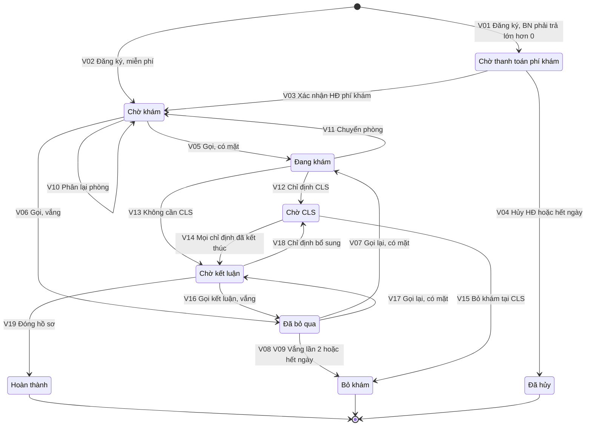
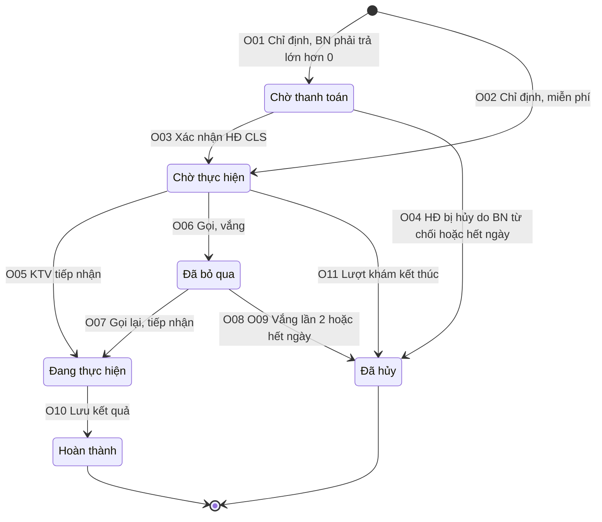
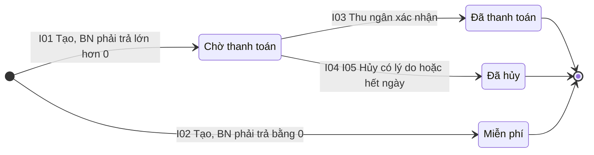

# State Transition — Hệ thống quản lý khám bệnh ngoại trú

| Mục | Nội dung |
| --- | --- |
| Phiên bản | v1 — bản nháp, chờ nhóm duyệt |
| Ngày | 13/10/2026 |
| Nguồn | `bo-tai-lieu-quy-trinh-nghiep-vu-v7.xlsx` (BR-29 và các sheet F01–F06), `usecases_v3.xlsx` (UC-01 → UC-67), quyết định nhóm ngày 13/10/2026 về Q-24, quyết định ngày 06/11/2026 về Q-31 (theo BR-22), đề xuất cho Q-18 và Q-25 |
| Phạm vi | Lượt khám, Chỉ định CLS, Hóa đơn, Hồ sơ bệnh án, Tài khoản, Dịch vụ, Phòng khám |

BR-29 trong bộ tài liệu v7 vẫn ở trạng thái "Đề xuất — cần nhóm duyệt", nên toàn bộ tài liệu này là bản nháp. Tài liệu bổ sung vào BR-29 các trạng thái **Đã bỏ qua** (Q-18) và **Đã hủy** (Q-25, lượt bỏ về trước khi trả phí). Trạng thái kết thúc **Đã chuyển phòng** bị bỏ theo quyết định Q-24.

## 0. Quy ước

Cột **Tình trạng** trong các bảng chuyển trạng thái dùng 4 nhãn:

| Nhãn | Ý nghĩa |
| --- | --- |
| Nguồn | Có trong BR hoặc bước quy trình đã xác nhận ở bộ tài liệu v7 |
| Quyết định | Nhóm đã chốt ngày 13/10/2026 nhưng chưa cập nhật vào bộ tài liệu v7 |
| Đề xuất | Đề xuất trong tài liệu này, chờ nhóm duyệt; luôn kèm mã Q |
| Mở | Chưa có phương án; chuyển trạng thái chưa được phép cho tới khi chốt |

Mã trạng thái viết không dấu, in hoa, dùng làm giá trị lưu trong cơ sở dữ liệu. Mã chuyển trạng thái: `V` = Lượt khám, `O` = Chỉ định CLS, `I` = Hóa đơn, `R` = Hồ sơ, `A` = Tài khoản, `D` = Dịch vụ, `P` = Phòng khám, `S` = quy tắc đồng bộ giữa các entity.

## 1. Tổng quan

| Entity | Trạng thái | Trạng thái kết thúc | Phân hệ | UC chính |
| --- | --- | --- | --- | --- |
| Lượt khám | 9 | Hoàn thành, Bỏ khám, Đã hủy | F01–F04 | UC-31, UC-40, UC-42, UC-43, UC-52, UC-65 |
| Chỉ định CLS | 6 | Hoàn thành, Đã hủy | F02–F03 | UC-43, UC-40, UC-57 → UC-59, UC-65 |
| Hóa đơn | 4 | Đã thanh toán, Miễn phí, Đã hủy | F01, F03 | UC-31, UC-43, UC-63 → UC-66 |
| Hồ sơ bệnh án (theo lượt) | 2 | Đã khóa | F05 | UC-41, UC-52 |
| Tài khoản | 2 | — | F06 | UC-07, UC-09 |
| Dịch vụ | 2 | — | F06 | UC-18 |
| Phòng khám | 2 | — | F06 | UC-13 |

## 2. Lượt khám

### 2.1 Danh sách trạng thái

| Mã | Tên | Ý nghĩa | Xuất hiện ở | Kết thúc |
| --- | --- | --- | --- | --- |
| `CHO_TT_PK` | Chờ thanh toán phí khám | Đã đăng ký, hóa đơn phí khám chưa được xác nhận đã thu | Danh sách hóa đơn chờ (UC-61) | Không |
| `CHO_KHAM` | Chờ khám | Đã trả hoặc miễn phí phí khám, đang chờ bác sĩ gọi | Danh sách chờ phòng (UC-39) | Không |
| `DA_BO_QUA` | Đã bỏ qua | Bác sĩ gọi nhưng bệnh nhân vắng; nằm trong danh sách bỏ qua | Danh sách bỏ qua của phòng | Không |
| `DANG_KHAM` | Đang khám | Bác sĩ đã gọi, bệnh nhân có mặt trong phòng | Màn hình khám (UC-41) | Không |
| `CHO_CLS` | Chờ CLS | Có ít nhất một chỉ định CLS chưa kết thúc | Danh sách chờ phòng, nhãn "đang làm CLS" | Không |
| `CHO_KET_LUAN` | Chờ kết luận | Không cần CLS, hoặc mọi chỉ định đã kết thúc | Danh sách chờ phòng, nhãn "đủ kết quả" | Không |
| `HOAN_THANH` | Hoàn thành | Bác sĩ đã đóng hồ sơ | Lịch sử khám | Có |
| `BO_KHAM` | Bỏ khám | Bệnh nhân bị bỏ qua và không quay lại, hoặc lượt chưa hoàn thành khi hết ngày (BR-22); không có kết luận | Lịch sử khám, thống kê | Có |
| `DA_HUY` | Đã hủy | Bệnh nhân bỏ về trước khi trả phí khám | Lịch sử khám, thống kê | Có |

Thuộc tính đi kèm lượt khám:

| Thuộc tính | Dùng cho |
| --- | --- |
| `uu_tien` (true/false) | Sắp xếp hàng chờ (BR-08, BR-26) |
| `thoi_diem_dang_ky` | Khóa sắp xếp hàng chờ (mục 2.4) |
| `phong_hien_tai`, `bac_si_hien_tai` | Phòng và bác sĩ đang phụ trách; đổi khi chuyển phòng hoặc phân lại |
| `bo_qua_tu` (`CHO_KHAM` / `CHO_KET_LUAN`) | Trạng thái để quay về khi gọi lại (V07, V17) |
| `so_lan_vang` | Đếm số lần gọi mà vắng, dùng cho V08 |
| `lich_su_phong` (log) | Mỗi lần chuyển phòng hoặc phân lại; phục vụ UC-21, UC-22 |

### 2.2 Sơ đồ

### 2.3 Bảng chuyển trạng thái

| ID | Từ | Sự kiện | Điều kiện | Đến | Thực hiện | UC | Bước / BR | Tình trạng |
| --- | --- | --- | --- | --- | --- | --- | --- | --- |
| V01 | — | Lễ tân đăng ký lượt khám; hệ thống tạo hóa đơn phí khám | Phần BN phải trả > 0 | `CHO_TT_PK` | Lễ tân, Hệ thống | UC-31 | F01-09, F01-11; BR-24, BR-29 | Nguồn |
| V02 | — | Lễ tân đăng ký lượt khám; hệ thống tạo hóa đơn phí khám | Phần BN phải trả = 0 | `CHO_KHAM` | Lễ tân, Hệ thống | UC-31 | F01-11; BR-24 | Nguồn |
| V03 | `CHO_TT_PK` | Thu ngân xác nhận đã thu hóa đơn phí khám (S1) | Hóa đơn phí khám chuyển `DA_TT` | `CHO_KHAM` | Thu ngân | UC-65 | F01-14; BR-18, BR-26 | Nguồn |
| V04 | `CHO_TT_PK` | Thu ngân hủy hóa đơn phí khám với lý do "BN không khám", hoặc tác vụ cuối ngày (S2) | Hóa đơn chưa thanh toán | `DA_HUY` | Thu ngân, Hệ thống | UC-66 | Mục 8 | Đề xuất |
| V05 | `CHO_KHAM` | Bác sĩ gọi bệnh nhân tiếp theo | Bệnh nhân có mặt | `DANG_KHAM` | Bác sĩ | UC-40 | F02-02; BR-29 | Nguồn |
| V06 | `CHO_KHAM` | Bác sĩ gọi bệnh nhân | Bệnh nhân vắng; ghi `bo_qua_tu = CHO_KHAM`, `so_lan_vang = 1` | `DA_BO_QUA` | Bác sĩ | UC-40 | F02-03; BR-10, BR-20 | Đề xuất (Q-18) |
| V07 | `DA_BO_QUA` | Bác sĩ bấm "Gọi lại" | `bo_qua_tu = CHO_KHAM`; bệnh nhân có mặt | `DANG_KHAM` | Bác sĩ | UC-40 | F02-03 | Đề xuất (Q-18) |
| V08 | `DA_BO_QUA` | Bác sĩ bấm "Bỏ khám" | Đã gọi lại ít nhất 1 lần mà vẫn vắng (`so_lan_vang ≥ 2`) | `BO_KHAM` | Bác sĩ | UC-40 | F02-03; BR-10 | Đề xuất (Q-18) |
| V09 | `DA_BO_QUA` | Tác vụ cuối ngày | Còn ở `DA_BO_QUA` lúc chạy tác vụ | `BO_KHAM` | Hệ thống | — | Mục 8; BR-10 | Đề xuất (Q-18) |
| V10 | `CHO_KHAM` | Lễ tân phân lại phòng do bác sĩ vắng đột xuất | Phòng mới đang hoạt động; ghi `lich_su_phong` | `CHO_KHAM` (phòng mới) | Lễ tân | UC-37 | F02-15; BR-12, BR-21 | Nguồn |
| V11 | `DANG_KHAM` | Bác sĩ chuyển bệnh nhân sang chuyên khoa khác | Lượt khám chưa có chỉ định CLS; giữ nguyên hóa đơn phí khám; ghi `lich_su_phong` | `CHO_KHAM` (phòng mới) | Bác sĩ | UC-42 | F02-05; BR-32 | Quyết định (Q-24) |
| V12 | `DANG_KHAM` | Bác sĩ tạo chỉ định CLS; hệ thống tạo hóa đơn CLS | Có ít nhất 1 chỉ định | `CHO_CLS` | Bác sĩ, Hệ thống | UC-43 | F02-10, F02-11, F03-01; BR-27 | Nguồn |
| V13 | `DANG_KHAM` | Bác sĩ chuyển sang kết luận | Không cần CLS, hoặc bệnh nhân từ chối CLS trước khi tạo chỉ định (bác sĩ ghi lý do vào kết quả khám) | `CHO_KET_LUAN` | Bác sĩ | UC-41, UC-48 | F02-12 | Nguồn; nhánh từ chối: Đề xuất (Q-25) |
| V14 | `CHO_CLS` | Chỉ định cuối cùng của lượt kết thúc (S5) | Mọi chỉ định ở `HOAN_THANH` hoặc `DA_HUY` với lý do `BN_TU_CHOI` | `CHO_KET_LUAN` | Hệ thống | — | F03-15; BR-27 | Nguồn; phần `DA_HUY`: Đề xuất (Q-25) |
| V15 | `CHO_CLS` | Một chỉ định bị hủy với lý do `BO_KHAM` (S6) | — | `BO_KHAM` | Hệ thống | — | F03-10; BR-10 | Đề xuất (Q-18) |
| V16 | `CHO_KET_LUAN` | Bác sĩ gọi bệnh nhân vào nghe kết luận | Bệnh nhân vắng; ghi `bo_qua_tu = CHO_KET_LUAN` | `DA_BO_QUA` | Bác sĩ | UC-40 | F04-01 | Đề xuất (Q-28) |
| V17 | `DA_BO_QUA` | Bác sĩ bấm "Gọi lại" | `bo_qua_tu = CHO_KET_LUAN`; bệnh nhân có mặt | `CHO_KET_LUAN` | Bác sĩ | UC-40 | F04-01 | Đề xuất (Q-28) |
| V18 | `CHO_KET_LUAN` | Bác sĩ chỉ định CLS bổ sung sau khi xem kết quả | Hồ sơ chưa khóa | `CHO_CLS` | Bác sĩ | UC-43 | — | Đề xuất (Q-30) |
| V19 | `CHO_KET_LUAN` | Bác sĩ đóng hồ sơ | Đã lưu kết luận (UC-50); đơn thuốc và lịch tái khám nếu có đã lưu | `HOAN_THANH` | Bác sĩ, Hệ thống | UC-52 | F04-08, F04-09; BR-11, BR-28 | Nguồn |
| V20 | `CHO_KHAM`, `DANG_KHAM`, `CHO_CLS`, `CHO_KET_LUAN` | Tác vụ cuối ngày | Lượt của ngày trước, chưa ở trạng thái kết thúc lúc chạy tác vụ | `BO_KHAM` | Hệ thống | — | Mục 8; BR-22 | Quyết định (Q-31) |

### 2.4 Ghi chú

**Hàng chờ phòng khám.** Danh sách chờ (UC-39) gồm các lượt `CHO_KHAM` và `CHO_KET_LUAN` của phòng, không gồm `CHO_TT_PK` (BR-26). Khóa sắp xếp thống nhất cho mọi phòng là `(uu_tien giảm dần, thoi_diem_dang_ky tăng dần)`. Số thứ tự chỉ dùng để hiển thị và gọi. Khóa này áp dụng cả cho lượt chuyển phòng (V11) và phân lại phòng (V10), khớp BR-21 và quyết định Q-24. *Quyết định (Q-24).*

**Gọi lại.** Lượt được gọi lại (V07, V17) được xử lý ngay sau ca đang khám, không xếp lại theo khóa sắp xếp. Con số "khoảng 10 lượt" của AS-IS (BR-20) chỉ là gợi ý hiển thị trên danh sách bỏ qua, không phải điều kiện chuyển trạng thái. *Đề xuất (Q-18).*

**Chuyển phòng.** Chỉ cho phép ở `DANG_KHAM` khi lượt chưa có chỉ định CLS, vì theo F02-04 quyết định chuyển chuyên khoa xảy ra trước khi mở hồ sơ khám. Không tạo hóa đơn phí khám mới, kể cả khi phí khám của chuyên khoa mới khác phí cũ. *Quyết định (Q-24).*

**Trạng thái "Đã chuyển phòng" bị bỏ.** Theo Q-24, lượt khám được dùng lại, nên chuyển phòng là một transition (V11) chứ không còn là điểm kết thúc. Lượt khám chỉ còn 3 trạng thái kết thúc: Hoàn thành, Bỏ khám, Đã hủy.

**Gọi bệnh nhân vào kết luận.** Thao tác gọi ở `CHO_KET_LUAN` không đổi trạng thái khi bệnh nhân có mặt; bác sĩ kết luận và đóng hồ sơ ngay trong trạng thái này.

**Chờ thanh toán CLS.** Không tách trạng thái con cho lượt khám khi hóa đơn CLS chưa trả. Thông tin này đọc từ trạng thái các chỉ định (`CHO_TT`) và hiển thị thành nhãn trên danh sách.

## 3. Chỉ định CLS

### 3.1 Danh sách trạng thái

| Mã | Tên | Ý nghĩa | Xuất hiện ở | Kết thúc |
| --- | --- | --- | --- | --- |
| `CHO_TT` | Chờ thanh toán | Hóa đơn CLS chứa chỉ định chưa được xác nhận đã thu | Phiếu chỉ định, danh sách hóa đơn chờ | Không |
| `CHO_TH` | Chờ thực hiện | Đã giải phóng tới phòng CLS | Danh sách chờ CLS (UC-56) | Không |
| `DA_BO_QUA` | Đã bỏ qua | KTV gọi nhưng bệnh nhân vắng | Danh sách bỏ qua của phòng CLS | Không |
| `DANG_TH` | Đang thực hiện | KTV đã tiếp nhận | Màn hình thực hiện (UC-58) | Không |
| `HOAN_THANH` | Hoàn thành | Đã lưu kết quả, kết quả gắn vào hồ sơ | Kết quả CLS (UC-49) | Có |
| `DA_HUY` | Đã hủy | Bệnh nhân từ chối, hoặc bỏ khám | Lịch sử chỉ định | Có |

Thuộc tính `ly_do_huy` của chỉ định nhận một trong hai giá trị: `BN_TU_CHOI` (bệnh nhân từ chối làm) hoặc `BO_KHAM` (bệnh nhân không quay lại, hoặc lượt khám đã kết thúc). Lượt khám có chỉ định `BN_TU_CHOI` mang nhãn "có CLS bị từ chối" khi về `CHO_KET_LUAN`.

### 3.2 Sơ đồ

### 3.3 Bảng chuyển trạng thái

| ID | Từ | Sự kiện | Điều kiện | Đến | Thực hiện | UC | Bước / BR | Tình trạng |
| --- | --- | --- | --- | --- | --- | --- | --- | --- |
| O01 | — | Bác sĩ tạo chỉ định; hệ thống tạo hóa đơn CLS | Phần BN phải trả của hóa đơn > 0 | `CHO_TT` | Bác sĩ, Hệ thống | UC-43 | F03-01, F03-02; BR-09, BR-29 | Nguồn |
| O02 | — | Bác sĩ tạo chỉ định; hệ thống tạo hóa đơn CLS | Phần BN phải trả của hóa đơn = 0 | `CHO_TH` | Bác sĩ, Hệ thống | UC-43 | F03-02, F03-07; BR-09 | Nguồn |
| O03 | `CHO_TT` | Thu ngân xác nhận hóa đơn CLS (S3) | Hóa đơn chuyển `DA_TT` | `CHO_TH` | Thu ngân, Hệ thống | UC-65 | F03-06, F03-07; BR-09, BR-27 | Nguồn |
| O04 | `CHO_TT` | Hóa đơn CLS bị hủy với lý do `BN_TU_CHOI_CLS` hoặc do tác vụ cuối ngày (S4) | Hóa đơn chưa thanh toán; `ly_do_huy` lấy theo lý do hủy hóa đơn | `DA_HUY` | Thu ngân, Hệ thống | UC-66 | — | Đề xuất (Q-25) |
| O05 | `CHO_TH` | KTV gọi và tiếp nhận chỉ định | Bệnh nhân có mặt; hóa đơn `DA_TT` hoặc `MIEN_PHI` | `DANG_TH` | Kỹ thuật viên | UC-40, UC-57 | F03-09, F03-11; BR-09, BR-29 | Nguồn |
| O06 | `CHO_TH` | KTV gọi bệnh nhân | Bệnh nhân vắng | `DA_BO_QUA` | Kỹ thuật viên | UC-40 | F03-10; BR-10, BR-20 | Đề xuất (Q-18) |
| O07 | `DA_BO_QUA` | KTV bấm "Gọi lại" và tiếp nhận | Bệnh nhân có mặt | `DANG_TH` | Kỹ thuật viên | UC-40, UC-57 | F03-10 | Đề xuất (Q-18) |
| O08 | `DA_BO_QUA` | KTV bấm "Bỏ khám" | Đã gọi lại mà vẫn vắng; `ly_do_huy = BO_KHAM` | `DA_HUY` | Kỹ thuật viên | UC-40 | F03-10; BR-10 | Đề xuất (Q-18) |
| O09 | `DA_BO_QUA` | Tác vụ cuối ngày | `ly_do_huy = BO_KHAM` | `DA_HUY` | Hệ thống | — | Mục 8 | Đề xuất (Q-18) |
| O10 | `DANG_TH` | KTV thực hiện và lưu kết quả | Đã nhập kết quả (giá trị, hình ảnh, kết luận) | `HOAN_THANH` | Kỹ thuật viên, Hệ thống | UC-58, UC-59 | F03-12 → F03-14; BR-29 | Nguồn |
| O11 | `CHO_TT`, `CHO_TH` | Lượt khám chuyển `BO_KHAM` (S6) | `ly_do_huy = BO_KHAM` | `DA_HUY` | Hệ thống | — | BR-10 | Đề xuất |
| O12 | `CHO_TH` | Bệnh nhân từ chối tại phòng CLS sau khi đã trả tiền | Không hoàn tiền (Q-10); trạng thái đích của chỉ định chưa chốt | — | — | — | — | Mở |

In và xem lại kết quả (UC-60) không đổi trạng thái chỉ định.

## 4. Hóa đơn

### 4.1 Danh sách trạng thái

| Mã | Tên | Ý nghĩa | Kết thúc |
| --- | --- | --- | --- |
| `CHO_TT` | Chờ thanh toán | Phần BN phải trả > 0, chưa được xác nhận đã thu | Không |
| `DA_TT` | Đã thanh toán | Thu ngân đã xác nhận đã thu | Có |
| `MIEN_PHI` | Miễn phí | Phần BN phải trả = 0, không qua thu ngân | Có |
| `DA_HUY` | Đã hủy | Hủy có lý do | Có |

Thuộc tính đi kèm:

| Thuộc tính | Giá trị |
| --- | --- |
| `loai` | `PHI_KHAM` (tạo khi đăng ký) hoặc `CLS` (tạo khi chỉ định) |
| `tien_bhyt`, `tien_bn_tra` | Tách theo BR-06; không có tiền thuốc (BR-33) |
| `da_xuat_luc`, `so_lan_in` | Ghi nhận UC-63, UC-64; không đổi trạng thái |
| `ly_do_huy` | `SAI_THONG_TIN`, `BN_KHONG_KHAM` (phí khám), `BN_TU_CHOI_CLS` (CLS), `HET_NGAY` (hệ thống) |
| `thay_the_cho` | Mã hóa đơn bị hủy mà hóa đơn này thay thế (I06) |

### 4.2 Sơ đồ

### 4.3 Bảng chuyển trạng thái

| ID | Từ | Sự kiện | Điều kiện | Đến | Thực hiện | UC | Bước / BR | Tình trạng |
| --- | --- | --- | --- | --- | --- | --- | --- | --- |
| I01 | — | Đăng ký lượt khám (phí khám) hoặc tạo chỉ định (CLS) | `tien_bn_tra > 0` | `CHO_TT` | Hệ thống | UC-31, UC-43 | F01-11, F03-01; BR-06, BR-09, BR-24 | Nguồn |
| I02 | — | Như I01 | `tien_bn_tra = 0` | `MIEN_PHI` | Hệ thống | UC-31, UC-43 | F01-11, F03-02; BR-09, BR-24; Q-19 | Nguồn |
| I03 | `CHO_TT` | Thu ngân xác nhận đã thu | Hóa đơn đã được xuất (`da_xuat_luc` có giá trị) | `DA_TT` | Thu ngân | UC-65 | F01-14, F03-06; BR-18 | Nguồn; điều kiện "đã xuất": Đề xuất |
| I04 | `CHO_TT` | Thu ngân hủy hóa đơn | Bắt buộc nhập `ly_do_huy` | `DA_HUY` | Thu ngân | UC-66 | F03-16; BR-18 | Nguồn; danh mục lý do: Đề xuất (Q-29) |
| I05 | `CHO_TT` | Tác vụ cuối ngày | `ly_do_huy = HET_NGAY` | `DA_HUY` | Hệ thống | — | Mục 8 | Đề xuất |
| I06 | — | Hủy với lý do `SAI_THONG_TIN` | Hệ thống tạo hóa đơn thay thế cùng nội dung đã sửa, ghi `thay_the_cho`; lượt khám và chỉ định giữ nguyên trạng thái | `CHO_TT` (hóa đơn mới) | Hệ thống | UC-66 | — | Đề xuất (Q-29) |
| I07 | `DA_TT` | Hủy hoặc hoàn tiền hóa đơn đã thanh toán | Không cho phép: không hoàn tiền | — | — | — | — | Quyết định (Q-10) |

Lý do hủy quyết định tác động sang entity khác (mục 7): `SAI_THONG_TIN` → tạo hóa đơn thay thế, không đổi lượt khám; `BN_KHONG_KHAM` → lượt khám `DA_HUY`; `BN_TU_CHOI_CLS` → chỉ định `DA_HUY`; `HET_NGAY` → theo mục 8.

## 5. Hồ sơ bệnh án (theo lượt khám)

| ID | Từ | Sự kiện | Điều kiện | Đến | UC | Bước / BR | Tình trạng |
| --- | --- | --- | --- | --- | --- | --- | --- |
| R01 | — | Tạo cùng lượt khám, chứa triệu chứng lễ tân nhập | — | `MO` (Mở) | UC-31, UC-32 | F01-08, F05-01 | Đề xuất |
| R02 | `MO` | Bác sĩ đóng hồ sơ (S7) | Lượt khám chuyển `HOAN_THANH` | `DA_KHOA` (Đã khóa) | UC-52 | F04-09; BR-28 | Nguồn |
| R03 | `MO` | Lượt khám chuyển `BO_KHAM` hoặc `DA_HUY` (S7) | — | `DA_KHOA` | — | — | Đề xuất |

Khi hồ sơ `MO`: bác sĩ ghi sinh hiệu, khám, kết luận, đơn thuốc, lịch tái khám (UC-41, UC-50, UC-53, UC-55); KTV ghi kết quả CLS (UC-59). Khi `DA_KHOA`: chỉ xem và xuất (UC-46, UC-47), không ai được sửa (BR-28).

## 6. Tài khoản, Dịch vụ, Phòng khám

| ID | Entity | Từ | Sự kiện | Điều kiện / tác động | Đến | UC | Tình trạng |
| --- | --- | --- | --- | --- | --- | --- | --- |
| A01 | Tài khoản | — | Admin tạo tài khoản | Gán 1 trong 5 vai trò (BR-34) | `HOAT_DONG` | UC-07, UC-08 | Nguồn |
| A02 | Tài khoản | `HOAT_DONG` | Admin khóa | Không đăng nhập được (UC-01); Admin không tự khóa chính mình; phiên đang mở bị kết thúc | `DA_KHOA` | UC-09 | Nguồn; 2 điều kiện sau: Đề xuất |
| A03 | Tài khoản | `DA_KHOA` | Admin mở khóa | — | `HOAT_DONG` | UC-09 | Nguồn |
| D01 | Dịch vụ | `DANG_HD` | Admin tắt dịch vụ | Không hiện khi chỉ định (UC-43, BR-23); chỉ định đã tạo không bị ảnh hưởng | `NGUNG_HD` | UC-18 | Nguồn |
| D02 | Dịch vụ | `NGUNG_HD` | Admin bật dịch vụ | — | `DANG_HD` | UC-18 | Nguồn |
| P01 | Phòng khám | `HOAT_DONG` | Admin ngừng phòng | Không hiện khi phân phòng (UC-37); chặn nếu phòng còn lượt `CHO_KHAM`, `DA_BO_QUA` hoặc `CHO_KET_LUAN` | `NGUNG_HD` | UC-13 | Đề xuất |
| P02 | Phòng khám | `NGUNG_HD` | Admin mở lại phòng | — | `HOAT_DONG` | UC-13 | Đề xuất |

Đặt lại mật khẩu (UC-10), đổi giá (UC-17) và phân công bác sĩ (UC-14) không đổi trạng thái. Danh mục không có UC tạo dịch vụ hay tạo phòng; dữ liệu này được nhập sẵn (F06-03, F06-04).

## 7. Quy tắc đồng bộ giữa các entity

| ID | Khi | Thì | Tình trạng |
| --- | --- | --- | --- |
| S1 | Hóa đơn `PHI_KHAM` → `DA_TT` | Lượt khám `CHO_TT_PK` → `CHO_KHAM` (V03) | Nguồn |
| S2 | Hóa đơn `PHI_KHAM` → `DA_HUY` với lý do `BN_KHONG_KHAM` hoặc `HET_NGAY` | Lượt khám → `DA_HUY` (V04) | Đề xuất |
| S3 | Hóa đơn `CLS` → `DA_TT` | Mọi chỉ định thuộc hóa đơn `CHO_TT` → `CHO_TH` (O03) | Nguồn |
| S4 | Hóa đơn `CLS` → `DA_HUY` với lý do `BN_TU_CHOI_CLS` | Mọi chỉ định thuộc hóa đơn → `DA_HUY`, `ly_do_huy = BN_TU_CHOI` (O04); sau đó kiểm tra S5 | Đề xuất (Q-25) |
| S5 | Một chỉ định chuyển `HOAN_THANH` hoặc `DA_HUY (BN_TU_CHOI)` | Nếu mọi chỉ định của lượt đã kết thúc và không có chỉ định nào `DA_HUY (BO_KHAM)`: lượt khám `CHO_CLS` → `CHO_KET_LUAN` (V14), thông báo cho bác sĩ | Nguồn; phần từ chối: Đề xuất |
| S6 | Một chỉ định chuyển `DA_HUY (BO_KHAM)` | Lượt khám → `BO_KHAM` (V15); các chỉ định khác chưa kết thúc → `DA_HUY (BO_KHAM)` (O11); hóa đơn CLS còn `CHO_TT` → `DA_HUY (HET_NGAY)` | Đề xuất (Q-18) |
| S7 | Lượt khám vào trạng thái kết thúc (`HOAN_THANH`, `BO_KHAM`, `DA_HUY`) | Hồ sơ → `DA_KHOA` (R02, R03); hóa đơn còn `CHO_TT` của lượt → `DA_HUY` | Nguồn với `HOAN_THANH`; còn lại: Đề xuất |

Các quy tắc S chạy trong cùng một giao dịch với sự kiện gốc, để không tồn tại trạng thái lệch giữa hóa đơn, chỉ định và lượt khám.

## 8. Tác vụ cuối ngày

Tác vụ này dọn các lượt bị bỏ dở, không phải bước "đóng lượt cuối ngày" để thu tiền đã bị bỏ ở thay đổi C-04. Giờ chạy cấu hình được (Q-32). *Đề xuất.*

| Bước | Đối tượng | Chuyển | Lý do ghi nhận |
| --- | --- | --- | --- |
| 1 | Lượt khám `CHO_TT_PK` và hóa đơn phí khám `CHO_TT` | Hóa đơn → `DA_HUY` (I05); lượt khám → `DA_HUY` (S2) | `HET_NGAY` |
| 2 | Lượt khám `DA_BO_QUA` | → `BO_KHAM` (V09); hồ sơ → `DA_KHOA` | `HET_NGAY` |
| 3 | Chỉ định `DA_BO_QUA` | → `DA_HUY (BO_KHAM)` (O09); kéo theo S6 | `HET_NGAY` |
| 4 | Chỉ định `CHO_TT` (bệnh nhân không trả CLS, cũng không báo từ chối) | Hóa đơn → `DA_HUY (HET_NGAY)`; chỉ định → `DA_HUY (BO_KHAM)`; kéo theo S6 | `HET_NGAY` |
| 5 | Lượt khám còn `CHO_KHAM`, `DANG_KHAM`, `CHO_CLS`, `CHO_KET_LUAN` | Lượt khám → `BO_KHAM` (V20), không có kết luận; kéo theo S7 (hồ sơ → `DA_KHOA`, hóa đơn còn `CHO_TT` → `DA_HUY (HET_NGAY)`); chỉ định chưa kết thúc → `DA_HUY (BO_KHAM)` (O11). Chỉ định đã trả nhưng chưa làm không được hoàn tiền; hóa đơn `DA_TT` giữ nguyên (Q-10) | `HET_NGAY` |

## 9. Chuyển trạng thái bị cấm

Danh sách này dùng để kiểm thử: mọi thao tác dưới đây phải bị hệ thống từ chối.

| Entity | Chuyển bị cấm | Lý do |
| --- | --- | --- |
| Lượt khám | `CHO_TT_PK` → `DANG_KHAM` | Chưa thu phí khám (BR-24, BR-26) |
| Lượt khám | `CHO_CLS` → `CHO_KHAM` (chuyển phòng khi đã có chỉ định) | Q-24: chỉ chuyển phòng trước khi chỉ định |
| Lượt khám | `CHO_CLS` → `HOAN_THANH` | Chưa đủ kết quả CLS (BR-27) |
| Lượt khám | `HOAN_THANH`, `BO_KHAM`, `DA_HUY` → bất kỳ | Trạng thái kết thúc; hồ sơ đã khóa (BR-28) |
| Chỉ định CLS | `CHO_TT` → `DANG_TH` | Chưa thanh toán (BR-09, UC-57) |
| Chỉ định CLS | `HOAN_THANH` → bất kỳ | Kết quả đã gắn vào hồ sơ |
| Hóa đơn | `MIEN_PHI` → `CHO_TT` | Số tiền được tính một lần khi tạo |
| Hóa đơn | `DA_TT` → `DA_HUY` | Không hoàn tiền (Q-10) |
| Hồ sơ | Sửa nội dung khi `DA_KHOA` | BR-28 |
| Tài khoản | Đăng nhập khi `DA_KHOA` | UC-09 |

## 10. Ảnh hưởng tới tài liệu khác

Khi nhóm duyệt tài liệu này, các vị trí sau cần cập nhật để đồng bộ:

| Tài liệu | Vị trí | Thay đổi |
| --- | --- | --- |
| Bộ tài liệu v7, sheet 08 | BR-29 | Thay bằng máy trạng thái ở mục 2–4: thêm `Đã bỏ qua`, `Đã hủy`; bỏ `Đã chuyển phòng` |
| Bộ tài liệu v7, sheet 08 | BR-32 | Lượt khám không kết thúc khi chuyển phòng mà quay về `Chờ khám` ở phòng mới, không thu thêm phí |
| Bộ tài liệu v7, sheet 08 | BR-10, BR-20 | Thêm quy tắc gọi lại một lần và tác vụ cuối ngày; "10 lượt" chỉ là gợi ý hiển thị |
| Bộ tài liệu v7, sheet 08 | BR-26 | Khóa sắp xếp `(ưu tiên, thời điểm đăng ký)` cho mọi phòng |
| Bộ tài liệu v7, sheet 08 | BR mới | Tác vụ cuối ngày (mục 8); danh mục lý do hủy hóa đơn (mục 4.3) |
| Bộ tài liệu v7, sheet 02 | Ghi chú cuối sheet | Trạng thái kết thúc: Hoàn thành, Bỏ khám, Đã hủy (bỏ "Đã chuyển phòng") |
| Bộ tài liệu v7, sheet 04 | F02-05 | Đầu ra: lượt khám về `Chờ khám` ở phòng mới, giữ hóa đơn |
| Bộ tài liệu v7, sheet 04 | F02-10 | Thêm nhánh bệnh nhân từ chối CLS (Q-25) |
| `usecases_v3.xlsx` | UC-42 | Bỏ "the visit in the current room ends as Transferred" |
| `usecases_v3.xlsx` | UC-40 | Thêm "Gọi lại" và "Bỏ khám" |
| `usecases_v3.xlsx` | UC-66 | Hủy bắt buộc chọn lý do; lý do quyết định tác động lên lượt khám và chỉ định |
| Sơ đồ BF-02 | Điểm kết thúc "Transferred" | Đổi thành vòng quay về hàng chờ phòng mới; bổ sung nhánh từ chối CLS (D-03) |
| `Project_Tracking.xlsx` | WBS | Ghi chú cũ "Self-paid: ..." ở UC-43, UC-57 và tên "BF-04 ... & Payment" lệch với v7 |

## 11. Câu hỏi mở

| Mã | Câu hỏi | Phương án trong tài liệu | Ảnh hưởng |
| --- | --- | --- | --- |
| Q-10 | Bệnh nhân đã trả tiền rồi bỏ khám hoặc từ chối CLS: có hoàn tiền không? | Đã quyết định 06/11/2026: không hoàn tiền; hóa đơn đã thanh toán không bị hủy (I07) | Hóa đơn, Chỉ định CLS; O12, I07 |
| Q-18 | Bỏ qua là trạng thái hay cờ; khi nào chuyển Bỏ khám? | Trạng thái riêng; gọi lại 1 lần; tác vụ cuối ngày làm lưới an toàn | V06–V09, O06–O09 |
| Q-24 | Chuyển phòng | Đã quyết định: dùng lại lượt cũ, xếp theo thời gian đến, không thu thêm phí | V11 |
| Q-25 | Bệnh nhân từ chối CLS | Trước chỉ định: ghi chú rồi kết luận; sau chỉ định: hủy hóa đơn, hủy chỉ định, về Chờ kết luận | V13, V14, O04, S4 |
| Q-28 *(mới)* | Bệnh nhân vắng khi được gọi vào nghe kết luận xử lý thế nào? | Dùng chung cơ chế bỏ qua, quay về `Chờ kết luận` | V16, V17 |
| Q-29 *(mới)* | Hủy hóa đơn sai thì tạo lại hóa đơn thế nào? | Hệ thống tự tạo hóa đơn thay thế khi lý do là `SAI_THONG_TIN` | I04, I06 |
| Q-30 *(mới)* | Bác sĩ có được chỉ định CLS bổ sung sau khi xem kết quả không? | Cho phép, lượt khám quay lại `Chờ CLS` | V18 |
| Q-31 *(mới)* | Lượt đã trả tiền nhưng chưa được khám hoặc đang dở lúc hết ngày xử lý thế nào? | Đã quyết định 06/11/2026 theo BR-22: tác vụ cuối ngày chuyển sang `BO_KHAM`; không hoàn tiền (Q-10) | V20; Mục 8, bước 5 |
| Q-32 *(mới)* | Tác vụ cuối ngày chạy lúc mấy giờ? | Cấu hình được | Mục 8 |